<!-- Header wave -->

  

  
  
  

---

## What I'm building

  

<table>
  <tr>
    <td width="96" align="center">
      <!-- Put Sarv's official logo at assets/sarv-logo.png -->
      
    </td>
    <td>
      <b><a href="https://crawl.sarv.com">SarvCrawl</a></b> is Sarv's web crawler. 
      I work on the crawler, its browser extension, and the AI services around it.
    </td>
  </tr>
</table>

<!-- Optional: product screenshots. Drop PNGs/GIFs in assets/ and uncomment.

  
  

-->

## Tech I use

  

## GitHub stats

  
  

  

## Contribution snake

  <picture>
    <source media="(prefers-color-scheme: dark)" srcset="https://raw.githubusercontent.com/sarvaman/sarvaman/output/github-snake-dark.svg"/>
    
  </picture>

